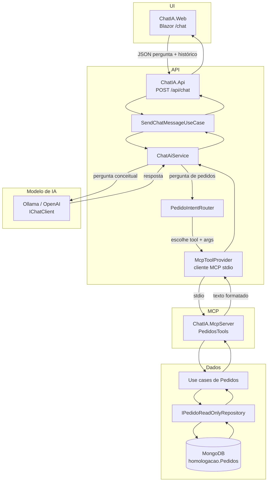

# ChatIA

Projeto de aprendizado: chatbot com **C# / .NET**, **MongoDB** e **MCP**, seguindo a Clean Architecture do [CashFlow](https://github.com/Mateus-R-De-Lima/CashFlow).

## Arquitetura

### Camadas (Clean Architecture)

```
src/
  ChatIA.Domain          → entidades, contratos (repositórios, IChatAiService)
  ChatIA.Application     → use cases
  ChatIA.Communication   → Request/Response JSON
  ChatIA.Exception       → exceções tipadas
  ChatIA.Infrastructure  → MongoDB, LLM (MEAI/OpenAI-compatible), cliente MCP
  ChatIA.Api             → host HTTP
  ChatIA.McpServer       → host MCP (tools de leitura)
  ChatIA.Web             → Blazor (UI do chat)
testes/
  UseCase.Tests, Validator.Tests, WebApi.Test, CommonTestUtilities
```

### Diagrama — fluxo IA, MCP e banco



### Dois caminhos de resposta

| Cenário | Exemplo | Caminho |
|---------|---------|---------|
| **A — Conceitual** | “O que é Clean Architecture?” | Api → LLM → resposta |
| **B — Dados / delivery** | “Quantos pedidos?”, “Itens do #12?” | Api → `PedidoIntentRouter` → MCP → use case → Mongo → texto |

Perguntas de pedidos são **roteadas no código** (não dependem do LLM escolher a tool). O histórico resolve follow-ups (“quais são eles?”, “que marca?”) reutilizando a ref. `#` da resposta anterior.

O `ChatIA.McpServer` sobe como processo filho via **stdio** quando a Api precisa das tools (não é necessário subir manualmente).

## Pré-requisitos

- .NET 9+
- MongoDB em `localhost:27017` (database `homologacao`, collection `Pedidos`)
- Ollama local **ou** chave OpenAI / endpoint compatível

## Configuração (`appsettings`)

Edite `src/ChatIA.Api/appsettings.json` (ou `appsettings.Development.json`):

```json
"ConnectionStrings": {
  "MongoDb": "mongodb://localhost:27017"
},
"Settings": {
  "Ai": {
    "ApiKey": "ollama",
    "Model": "llama3.2:1b",
    "Endpoint": "http://localhost:11434/v1"
  }
}
```

| Chave | Uso |
|-------|-----|
| `Settings:Ai:ApiKey` | OpenAI, ou qualquer string se usar Ollama local |
| `Settings:Ai:Endpoint` | Vazio = OpenAI oficial; Ollama: `http://localhost:11434/v1` |
| `ConnectionStrings:MongoDb` | MongoDB |

Evite commitar chaves reais no Git.

## Como executar

```bash
dotnet build ChatIA.sln

# Terminal 1 — Api (sobe o McpServer automaticamente via stdio)
dotnet run --project src/ChatIA.Api

# Terminal 2 — Blazor
dotnet run --project src/ChatIA.Web
```

Abra o chat em `/chat`.

Endpoints HTTP de pedidos (sem IA, úteis para testar o Mongo):

- `GET /api/pedidos/count`
- `GET /api/pedidos/latest?limit=10`
- `GET /api/pedidos/{shortReference}`
- `GET /api/pedidos/revenue?year=2025&month=9`

## Tools MCP

Implementação: `src/ChatIA.McpServer/Tools/PedidosTools.cs`.  
Todas são **somente leitura**. Sem query arbitrária e sem escrita no MongoDB.

| Tool | Parâmetros | O que faz | Retorno (resumo) |
|------|------------|-----------|------------------|
| `get_pedidos_count` | — | Conta documentos em `Pedidos` | `Total de pedidos cadastrados: N` |
| `get_latest_pedidos` | `limit` (1–50, padrão 10) | Lista resumida dos mais recentes | Linhas com `#ref`, cliente, total, canal, tipo, data |
| `get_latest_pedido_detail` | — | Detalhe **completo** do último pedido | Cliente, telefone, itens, pagamentos, tipo, canal, total |
| `get_pedido_by_reference` | `shortReference` (int) | Detalhe **completo** pela ref. curta `#` | Idem ao detalhe; ou “não encontrado” |
| `get_monthly_revenue` | `year`, `month` (1–12) | Soma do campo `total` no mês/ano | `Faturamento de MM/AAAA: X.XX` |

### Detalhe completo (o que vem do banco)

Usado por `get_latest_pedido_detail` e `get_pedido_by_reference`:

| Área | Campos |
|------|--------|
| Pedido | `shortReference`, `pedido_id`, `total`, `type`, `salesChannel`, `createdAt` |
| Cliente | nome, telefone, documento |
| Itens | nome, quantidade, preço unitário, total, observação |
| Pagamentos | nome, código, valor, pré-pago |

**Não existe** campo separado de marca — marca/sabor costuma estar no **nome do item** ou na **observação**.

### Exemplos de perguntas → tool

| Intenção | Exemplos | Tool |
|----------|----------|------|
| Contagem | Quantos pedidos? Total de pedidos? | `get_pedidos_count` |
| Lista | Últimos 5 pedidos; pedidos recentes | `get_latest_pedidos` |
| Último completo | Qual o último pedido? Itens do último? | `get_latest_pedido_detail` |
| Detalhe / itens | Detalhes do pedido 12; itens do #5 | `get_pedido_by_reference` |
| Follow-up | Quais são eles? Que marca? E o cliente? | `get_pedido_by_reference` (via histórico) |
| Cliente | Quem pediu? Telefone do pedido 8? | `get_pedido_by_reference` |
| Pagamento | Como pagou? Foi PIX? | `get_pedido_by_reference` |
| Tipo/canal | É delivery ou retirada? Canal Anota/iFood? | `get_pedido_by_reference` |
| Faturamento | Faturamento de setembro/2025 | `get_monthly_revenue` |

## Testes

```bash
dotnet test ChatIA.sln
```

## Segurança (aprendizado)

- Não versionar API keys nem senhas do Mongo (User Secrets / env vars).
- Tools MCP específicas e limitadas.
- Sem operações de escrita no Mongo via MCP.
